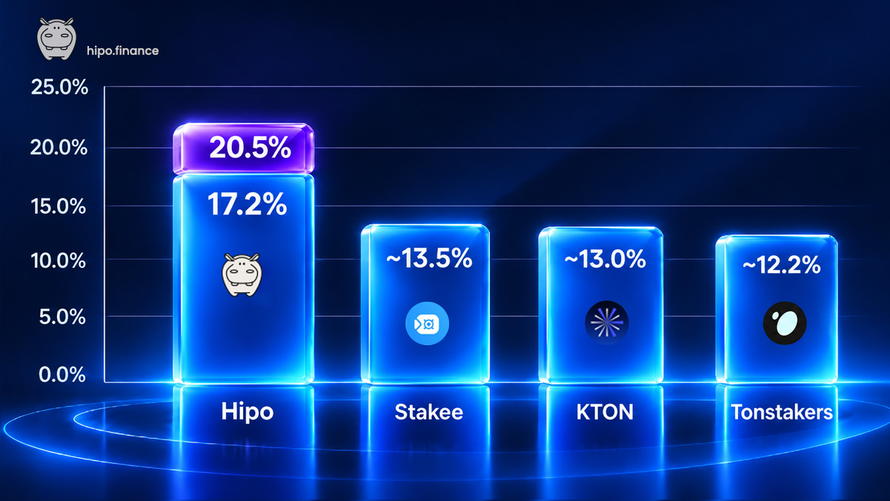

This is the third edition of our quarterly benchmark series.

In [Q1](/blog/gram-staking-benchmark-q1-2026/), we ran a 6-day test across six protocols. In [Q2](/blog/gram-staking-benchmark-q2-2026/), we extended the experiment to 45 days. For Q3, we ran the test for approximately 93 days, covering 122 validation rounds.

Our principle remains the same:

> Measure what users actually earn, not what protocols advertise.

**The result:** Hipo returned **104.1445 GRAM** from 100 GRAM, net of all measured fees. That's an annualized return of approximately **17.2%**.

The next-best protocol, Stakee, returned 103.2841 GRAM, or approximately 13.5% APY. Hipo generated a 26.2% larger net gain than the next-best protocol.

On top of base staking, Hipo stakers also accrue HPO rewards through Hipo Club. We measure these separately because they are paid in another token and have different claim conditions and market risks.

## What's new in this benchmark

Compared with our previous tests, Q3 introduces several improvements:

- **A longer testing period.** Approximately 93 days, compared with 45 days in Q2 and 6 days in Q1.
- **The same four protocols as Q2.** Hipo, KTON, Stakee and Tonstakers. Bemo and TonWhales remain excluded for the reasons explained in our Q2 report.
- **More complete fee accounting.** We counted every GRAM flow related to each position, including deposit gas, gas sent with unstake requests, returned gas and final payouts.
- **Withdrawal timing included.** Each protocol paid out at a different time, so we report annualized returns using both each position's actual holding period and a common comparison window.
- **Base staking and HPO rewards remain separate.** This allows us to compare native staking returns fairly while showing Hipo Club rewards as an additional benefit.

## Benchmark methodology

To keep the experiment transparent and reproducible, we used the following methodology:

- **Wallet:** [Public benchmark wallet](https://tonviewer.com/UQAdtoa9kIagpWX8tRFErQyFybG5KwHj7pB8go6om5yZvorF) `UQAdtoa9kIagpWX8tRFErQyFybG5KwHj7pB8go6om5yZvorF`, the same wallet used in Q1 and Q2.
- **Amount:** 100 GRAM in each protocol.
- **Entry:** All four positions were deposited within approximately two minutes on August 9, 2026 (11:11–11:14 UTC).
- **Exit:** All four unstake requests were submitted within approximately two minutes on November 10, 2026 (08:57–08:59 UTC), using each protocol's default unstaking process.
- **No intervention:** No top-ups, HPO claims or manual compounding took place during the test.
- **Net return:** We counted the initial 100 GRAM deposit, deposit gas, gas sent with the unstake request, any gas returned, and the final payout. Unrelated transfers to the wallet were excluded.
- **Annualization:** We used the same compounded formula as in previous reports: `APY = (Final GRAM / 100)^(365 / Days held) − 1`

Each protocol's final result is based on the GRAM actually returned to the benchmark wallet, rather than the market price of its liquid staking token.

### Position details

Each protocol issues its own liquid staking token. Consequently, 100 GRAM buys a different number of tokens in each protocol. The entry exchange rate is provided for reference; the number of tokens received alone does not determine staking performance.

| Protocol | Token received | Entry rate (GRAM/token) | Unstake request (UTC) | Final payout (UTC) |
| --- | --- | --- | --- | --- |
| Hipo | 86.9859 hGRAM | 1.14961 | Nov 10, 08:59 | Nov 11, 02:13 |
| Stakee | 87.9020 STAKED | 1.13763 | Nov 10, 08:57 | Nov 10, 08:57 (instant) |
| KTON | 94.7870 KTON | 1.05500 | Nov 10, 08:58 | Nov 10, 17:10 |
| Tonstakers | 87.4735 tsTON | 1.14320 | Nov 10, 08:58 | Nov 11, 02:26 |

## Final returned amount

After approximately 93 days, this is how much GRAM each protocol returned from an initial 100 GRAM position, after accounting for the measured fees.

| Protocol | GRAM returned | Net gain | Net gain on 10,000 GRAM |
| --- | --- | --- | --- |
| **Hipo** | **104.1445** | **+4.1445** | **+414.5** |
| Stakee | 103.2841 | +3.2841 | +328.4 |
| KTON | 103.1767 | +3.1767 | +317.7 |
| Tonstakers | 103.0032 | +3.0032 | +300.3 |

Hipo returned 0.86 GRAM more than Stakee, 0.97 more than KTON and 1.14 more than Tonstakers for every 100 GRAM staked.

In relative terms, Hipo's net gain was:

- 26.2% higher than Stakee's.
- 30.5% higher than KTON's.
- 38.0% higher than Tonstakers'.

The differences become more meaningful as the position grows. With 10,000 GRAM, Hipo generated approximately 86 to 114 additional GRAM compared with the other tested protocols over this period.

## Annualized performance (compounded)

A 93-day return is useful for understanding what actually happened, but annualization allows us to compare results over different testing periods.

Because each protocol paid out at a different time, we calculated APY in two ways:

1. **Actual holding period:** From the initial deposit until the final GRAM payout.
2. **Common comparison window:** The same 92.9-day period for all protocols, from the first deposit to the last unstake request.

| Protocol | Days from deposit to payout | APY over actual holding period | APY over common 92.9-day window |
| --- | --- | --- | --- |
| **Hipo** | **93.6** | **\~17.2%** | **\~17.3%** |
| Stakee | 92.9 | \~13.5% | \~13.5% |
| KTON | 93.2 | \~13.0% | \~13.1% |
| Tonstakers | 93.6 | \~12.2% | \~12.3% |

<figure>

<figcaption>APY over each position's actual holding period. Hipo's 20.5% includes indicative HPO rewards at Club Level 10.</figcaption>

</figure>

The ranking remains the same under both methods, and no protocol's APY changes by more than 0.15 percentage points.

For the main comparison, we use the actual deposit-to-payout period because it represents how long the capital remained unavailable to the user.

**Hipo leads for the third benchmark in a row**, with an advantage of approximately 3.6 percentage points over the next-best protocol. In Q2, the gap was approximately 3.0 percentage points.

## Keeping the comparison fair

Several details can affect a benchmark like this. Here is how we accounted for them.

### 1. Different payout times

Although all four unstake requests were submitted within two minutes, the final GRAM payouts arrived at different times.

- Stakee paid instantly from its liquidity buffer.
- KTON paid approximately 8 hours later, at its round boundary.
- Hipo paid approximately 17 hours later, after the validation round's stakes were released.
- Tonstakers paid approximately 17.5 hours later.

These differences matter to users because they affect how long their capital remains unavailable. That's why our headline APY uses each protocol's actual deposit-to-payout time rather than assuming all withdrawals were instant.

### 2. Protocol and borrower fees

Hipo's protocol staking fee was **0% throughout the entire benchmark**, following its reduction in early June 2026. This means no portion of the native staking rewards was deducted as a protocol fee.

Hipo also introduced its Borrower Fee Mechanism on September 7, 2026, during the testing period. This is a separate fee paid by validators borrowing staked GRAM. It is charged on the validator's own share of the reward, on top of what it commits to the pool, and is used to buy and burn HPO.

Importantly, this fee comes from the borrower's side. It is not deducted from the staking rewards allocated to the pool and does not reduce the staker's exchange rate.

We do not have independently verified fee figures for the other protocols, so we do not make an unsupported comparison of their fee structures.

### 3. Network transaction fees

Every protocol requires additional GRAM for certain transactions, including unstaking. Some of the unused gas is returned.

We counted these flows instead of assuming the full amount sent with a transaction was permanently spent.

For Hipo, 0.1005 GRAM was sent with the unstake request, and approximately 0.093 GRAM was returned as part of the payout.

This ensures that the final comparison reflects the net amount received by the wallet, after the measured network transaction costs.

### 4. Actual redemption rates

We measured the GRAM each protocol actually paid back, rather than relying on DEX prices for liquid staking tokens.

For Hipo, the hGRAM exchange rate increased from 1.14961 GRAM at entry to 1.19737 GRAM at exit, representing approximately 4.15% growth during the test.

You can independently check Hipo's exchange rate and protocol information on our [Verify page](/verify/).

## Beyond base staking: HPO rewards

The 17.2% APY above represents **base GRAM staking rewards only**.

Hipo stakers can also earn HPO through [Hipo Club](/club/). Their HPO reward multiplier depends on their Club level, ranging from 1× at Level 1 to 10× at Level 10.

During this benchmark, the wallet accrued **18.51 HPO at Level 1**. With a 10× Level 10 multiplier, the same position would have accrued approximately **185.1 HPO**.

To illustrate the additional value, we can convert these amounts using the market prices on November 11, 2026:

- HPO: approximately $0.004662, according to the [Hipo HPO page](/hpo/).
- GRAM: approximately $1.14, according to [CoinGecko](https://www.coingecko.com/en/coins/gram).
- Reference conversion: approximately 0.00409 GRAM per HPO.

| Scenario | HPO accrued | Indicative HPO value | Combined value before claim fee | Illustrative annualized return |
| --- | --- | --- | --- | --- |
| Base staking | – | – | 104.1445 GRAM | \~17.2% |
| Base + HPO at Level 1 | 18.51 | \~0.0757 GRAM | 104.2202 GRAM | \~17.5% |
| Base + HPO at Level 10 | 185.1 | \~0.7570 GRAM | 104.9015 GRAM | \~20.5% |

**These combined figures are indicative, not realized GRAM returns.** They use one HPO price snapshot and do not account for future price changes, selling slippage or the HPO claim fee.

Hipo Club allows users to claim once they have accumulated at least 100 HPO, with a 1 GRAM claim fee. The Level 1 rewards from this test alone are below that threshold. The Level 10 estimate is above it, but its indicative market value is still lower than the 1 GRAM claim fee. For a 10,000 GRAM position at Level 10, the same period would accrue about 18,510 HPO, worth roughly 75.7 GRAM, so the 1 GRAM claim fee becomes negligible.

We show these figures to illustrate the additional HPO rewards generated by Hipo Club, not to present them as guaranteed or directly comparable to the base staking APYs of other protocols.

## Benchmark series so far

This is the third report in our quarterly benchmark series.

| Benchmark | Test period | Hipo APY | Best other protocol | Next-best APY |
| --- | --- | --- | --- | --- |
| Q1 2026 | \~6 days | **22.6%** | Tonstakers | 16.3% |
| Q2 2026 | \~45 days | **16.7%** | KTON | 13.7% |
| Q3 2026 | \~93 days | **17.2%** | Stakee | 13.5% |

The best-performing competitor changed in every benchmark: Tonstakers in Q1, KTON in Q2 and Stakee in Q3.

The absolute yields reflect different testing periods and network conditions, so they should not be compared as if they were measured simultaneously. What matters is the result within each experiment: **Hipo delivered the highest realized base staking return in all three benchmarks.**

The advantage over the next-best protocol has remained at approximately 3 percentage points or more, even as the test period became significantly longer.

## Why Hipo continues to lead

Two main features help explain Hipo's higher net staking returns.

### 1. A 0% protocol fee

Hipo currently takes no protocol fee from native staking rewards. As a result, the full staking reward allocated to the pool increases the hGRAM exchange rate.

The 0% fee has been in place since June 2026 and was announced as temporary. There is currently no fixed date for changing it.

### 2. An open validator market

Hipo does not depend on a fixed, hand-picked group of validators.

Validators compete through an open on-chain auction for the right to borrow staked GRAM. Their bids determine the rewards they commit to return to the pool.

In some rounds, a validator may offer more than the network's base staking reward to win access to the capital. That additional reward can increase the return received by Hipo stakers.

For a more detailed explanation of this mechanism, see our article: [Why Is Hipo's APY Higher, and Is It Safe?](/blog/why-hipo-apy-is-higher/).

### How validator collateral protects the pool

The open market is supported by a collateral requirement.

Every borrowing validator must lock its own GRAM as collateral, covering the maximum slashing penalty for the round plus the reward it has promised. If a penalty is imposed, it is taken from the validator's collateral rather than directly from staked GRAM.

This mechanism is designed to protect the pool from validator-level penalties. It does not eliminate all protocol or smart-contract risks, but it provides an important layer of protection for stakers.

## Limitations

This benchmark is designed to be transparent and reproducible, but it has limitations:

- **One wallet and one testing period.** Each protocol was tested using a single 100 GRAM position. Results may differ with larger deposits, different periods or changing network conditions.
- **Self-reported research.** Hipo operates one of the protocols being compared and prepared this report. We publish the public wallet so anyone can independently reproduce the calculations.
- **Annualized returns are extrapolations.** APY assumes the observed return continues at the same rate for a full year. The actual GRAM returned over the test period is the measured result.
- **Variable staking rewards.** Actual returns change with network rewards, validator bids, pool conditions and protocol fees.
- **Temporary 0% fee.** Hipo's protocol staking fee may change in the future. Any change would affect subsequent benchmarks.

## Conclusion

Over approximately 93 days and 122 validation rounds, Hipo turned 100 GRAM into **104.1445 GRAM**, after accounting for the measured fees. That's an annualized return of approximately **17.2%**.

The other three protocols returned between 103.0032 and 103.2841 GRAM, equivalent to approximately 12.2%–13.5% APY.

This is the **third consecutive benchmark in which Hipo delivered the highest realized base staking return** among the tested TON liquid staking protocols.

On top of this, Hipo stakers can accrue additional HPO rewards through Hipo Club, with multipliers of up to 10× at Level 10.

Our goal with this series is not simply to publish another APY comparison. It is to make staking performance measurable, transparent and independently verifiable.

The method remains straightforward: the same amount, nearly the same entry and exit times, a public wallet and actual on-chain results.

If you think something should be measured differently or have suggestions for the next benchmark, join the discussion in [Hipo Chat](https://t.me/hipo_chat).

We plan to continue the series with our Q4 benchmark in early 2027.

---

**Stake GRAM with Hipo** and receive hGRAM, a liquid staking token that grows in GRAM value as validation rewards accumulate.

At the time of publication, Hipo has approximately 8.81 million GRAM staked.

[Stake GRAM with Hipo](/stake/) · [Hipo Stats](/stats/) · [Compare Hipo with other protocols](/vs/)
