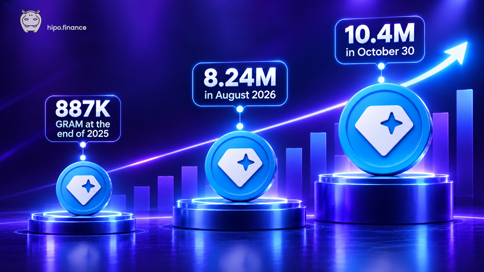
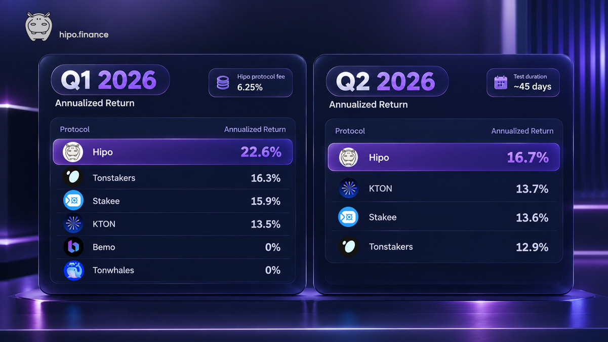
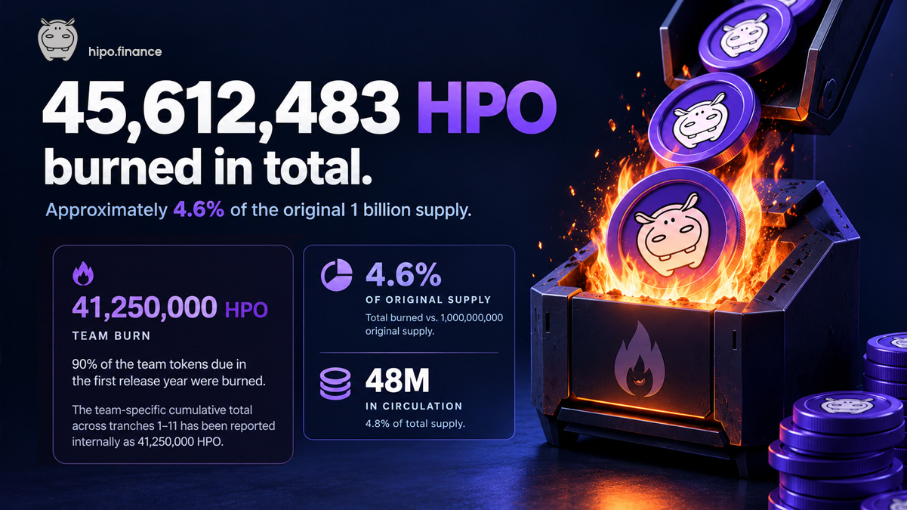
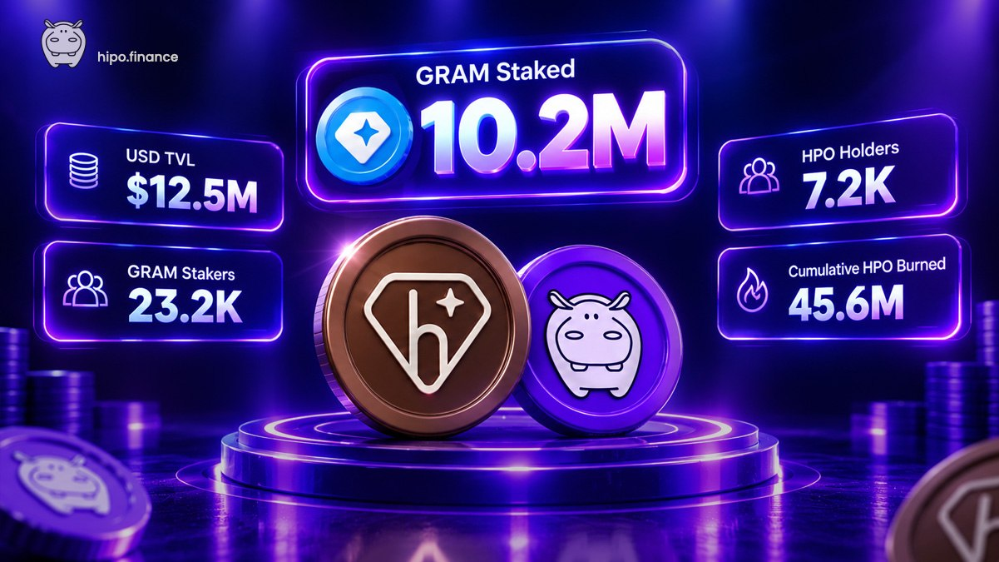

On 30 October 2023, Hipo went live on TON mainnet with a simple idea: liquid staking should be open, transparent, and accessible to anyone. Our goal was to build a truly decentralized protocol with its community at the centre.

Three years later, Hipo has grown from around **890,000 GRAM staked on 30 October 2025 to over 10.3 million GRAM today**, and has moved to **#4 in the TON ecosystem by TVL on DeFiLlama**. It has also weathered a major setback. On 1 June 2026, Hipo fell below the stake required to validate and temporarily stopped earning staking rewards. The recovery that followed tested our protocol, our team, and our community.

Year three wasn't a straight line up. This report looks back at the progress made between October 2025 and October 2026, what we learned, and what we're building next.

We start with the commitments we made a year ago.

**1. Build a strong community that truly owns Hipo.** HPO holders helped decide the year's biggest questions: the Season 3 allocation and claim price, the reward rate for every Hipo Club level, whether to accept a rescue offer in June, and the rules for the Hipo Fund.

**2. Grow hGRAM's TVL and integrations.** Staked GRAM grew from around **890,000 GRAM on 30 October 2025 to over 10.3 million GRAM today**. Hipo staking became available in Gate's Web3 Wallet, Swap.Coffee Yield, and the GroypFi SuperApp. Liquidity positions involving hGRAM on DeDust, STON.fi, and Tonco can qualify for boosted HPO rewards.

**3. Make HPO more useful.** Hipo Club distributes HPO rewards to eligible stakers every validation round. Since September, fees paid by validators borrowing staked GRAM have also funded HPO market purchases and burns.

**4. Scale the Hipo Fund.** The Fund is smaller in dollar terms than a year ago, largely because asset prices fell. We did, however, give it a clearer framework: in September, HPO holders ratified an Investment Policy Statement governing how the Fund is managed.

## An open validator market, measured on-chain

Hipo does not rely on a fixed, hand-picked group of validators. Validators compete through Hipo's permissionless on-chain market for the right to borrow staked GRAM. Their bids determine the rewards they commit to return, and their own collateral backs those commitments.

This year, we put Hipo's performance to the test with two public on-chain benchmarks. In each test, we staked the same amount across competing liquid staking protocols and measured the GRAM returned after fees.

In our **Q1 2026 benchmark**, Hipo delivered an annualized return of **22.6%**, compared with **16.3%** for the next-best tested protocol, Tonstakers. Hipo was still charging a 6.25% protocol fee during that test.

In our **Q2 2026 benchmark**, which ran for about 45 days, Hipo returned **16.7% annualized**, ahead of KTON at **13.7%**, Stakee at **13.6%**, and Tonstakers at **12.9%**.

The tests took place under different network conditions and over different periods, so their absolute rates should not be compared directly. The important result is that Hipo delivered the highest realized base staking return in both tests. The reports include the methodology and on-chain results so anyone can check them.

- [Read the Q1 2026 benchmark](https://hipo.finance/blog/gram-staking-benchmark-q1-2026/)
- [Read the Q2 2026 benchmark](https://hipo.finance/blog/gram-staking-benchmark-q2-2026/)

## Returning staking rewards to stakers

On 6 June 2026, Hipo reduced its protocol staking fee to **0%**. Hipo currently takes no protocol fee from staking rewards, so staking rewards are passed to stakers in full.

The change followed a difficult week. A large withdrawal temporarily left Hipo below the stake needed to validate, and the protocol did not validate from 1 June to 6 June. Stakers did not lose their deposited GRAM, but their stake did not earn validation rewards during that pause. We shared what happened and set the fee to 0% as part of rebuilding the pool.

The change has a trade-off: with no protocol fee, Hipo currently generates no fee revenue, so HPO profit sharing is paused. The 0% fee was announced as temporary, and no date has been set for a change. Any decision about the fee will be made with the community.

## Making the product clearer and more transparent

We shipped several improvements to make Hipo easier to understand, verify, and use.

- **Hipo Stats.** In August 2026, we launched Hipo Stats, bringing live protocol metrics and historical charts into one place, including total GRAM staked, APY, token data, and the hGRAM/GRAM rate. [Explore Hipo Stats](https://hipo.finance/stats/).
- **hTON became hGRAM.** In June 2026, we renamed our liquid staking token to reflect the ecosystem's move to the GRAM identity. The change did not affect balances, staking mechanics, or rewards. [Read why we made the change](https://hipo.finance/blog/hton-renamed-to-hgram/).
- **A redesigned Hipo website.** We unified and redesigned the website, expanded it to 11 languages, and introduced new Verify, comparison, and blog pages. The [Verify page](https://hipo.finance/verify/) lists official addresses and accounts and explains what Hipo will never ask users to do. The [comparison page](https://hipo.finance/vs/) helps users understand fees, rewards, and unstaking.
- **Hipo MCP Server.** We launched an MCP server that lets compatible AI assistants and developer tools access Hipo documentation and live staking data. [Explore the Hipo MCP Server](https://hipo.finance/docs/hipo-mcp-server/).

These changes follow the same principle: important protocol information should be easy to find, and users should be able to verify it for themselves.

## HPO: more utility, and burns that can be verified

Over the past year, we connected HPO more closely to Hipo's staking activity, community participation, and long-term growth. Over this period, **8,068,828.29 HPO was distributed and 42,519,872.40 HPO was burned**, according to Hipo's period totals.

- **Hipo Club rewards.** In late 2025, we introduced a new Hipo Club model. Since 30 November, Hipo stakers have earned boosted HPO rewards on top of their normal staking rewards every validation round, with multipliers ranging from **1× at Level 1 to 10× at Level 10**.

- **Borrower fees buy and burn HPO.** Launched on 7 September 2026, this mechanism charges validators a fee each round for borrowing staked GRAM. The proceeds are used to buy HPO on the market and burn it. In its first month, from 7 September to 7 October, the mechanism burned **554,654 HPO across 111 transactions**. As Hipo's TVL grows, validator activity and borrowing demand can grow too, creating the potential for more HPO buy-and-burn activity for the benefit of HPO holders.

- **90% of first-year team unlocks burned.** We extended the team's token release schedule from 24 to 48 months and committed to burning 90% of the team tokens unlocked during the first 12 months. So far, tranches 1–11 have accounted for a reported **41,250,000 HPO burned**. One tranche remains to complete the first-year commitment.

As of **30 October 2026**, Hipo's live HPO page showed **45,627,421 HPO burned in total**, about **4.56% of the original 1 billion supply**, approximately **48 million HPO in circulation**, and **7,175 holders**. The cumulative counter includes burns from multiple mechanisms, not just team-token burns.

[Check HPO tokenomics and the live burn counter](https://hipo.finance/hpo/).

## A clearer framework for Hipo Fund

In September, HPO holders ratified the Hipo Fund's Investment Policy Statement. The vote received **7.8 million HPO in favour from 37 wallets, with no votes against**.

The policy establishes target allocations, risk limits, eligible assets, custody requirements, and quarterly reporting. It prohibits leverage and requires a 2-of-3 multisig for fund operations. Changes to the policy require another DAO vote.

This was an important step toward making the Fund's management more predictable and accountable. The community sets the framework; the three team-member signers are responsible for carrying it out within those rules. The Fund does not charge a management or performance fee.

Read the [August 2026 Hipo Fund report](https://hipo.finance/docs/hipo-fund/quarterly-report-august-24-2026/).

## Three years of building together

In the days before our third anniversary, Hipo had grown from around **890,000 GRAM staked on 30 October 2025 to over 10.3 million GRAM today**, moving to **#4 in the TON ecosystem by TVL on DeFiLlama**.

None of these milestones happened in isolation. Community feedback helped shape the deposit flow, DEX reward integrations, website, and governance process. The benchmarks made our performance easier to examine. The borrower-fee mechanism created an innovative new way to return value generated by the Hipo protocol to HPO holders. And the Fund's policy gave holders a clearer say in how treasury assets are managed.

## What's next

Hipo Club Season 6 starts on **31 October 2026**. In November, we'll publish the Q3 staking benchmark and burn the final team tranche covered by the first-year commitment. The protocol fee remains at 0%, and whether or when it changes is a decision we'll make with the community in [Hipo Chat](https://t.me/hipo_chat).

Thank you to everyone who staked, held hGRAM or HPO, provided liquidity, voted, reported a problem, or helped someone else understand Hipo. And thank you for staying, especially in June.

**Three years down. We're still building.**

[Stake GRAM with Hipo](https://hipo.finance/stake/) · [Explore HPO](https://hipo.finance/hpo/) · [Join the Hipo community](https://t.me/hipo_chat)
